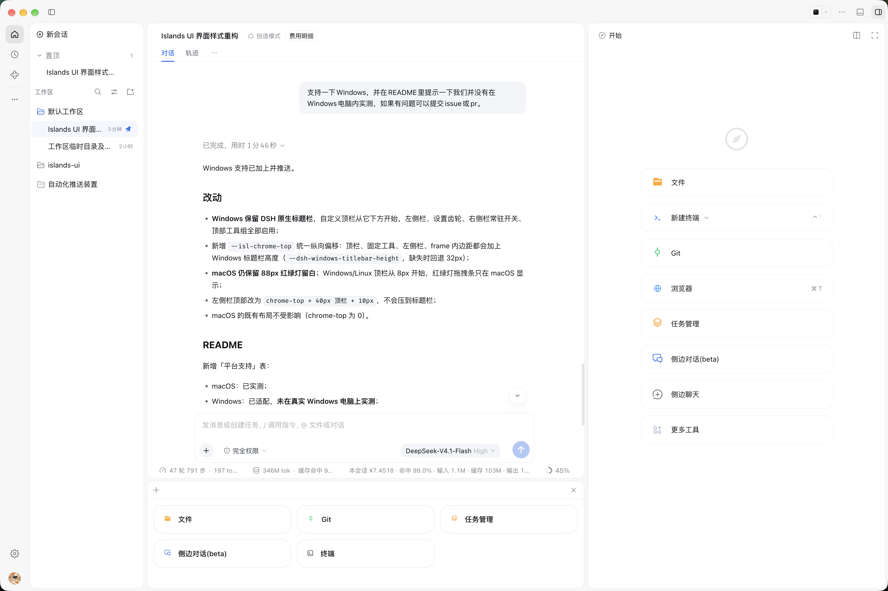
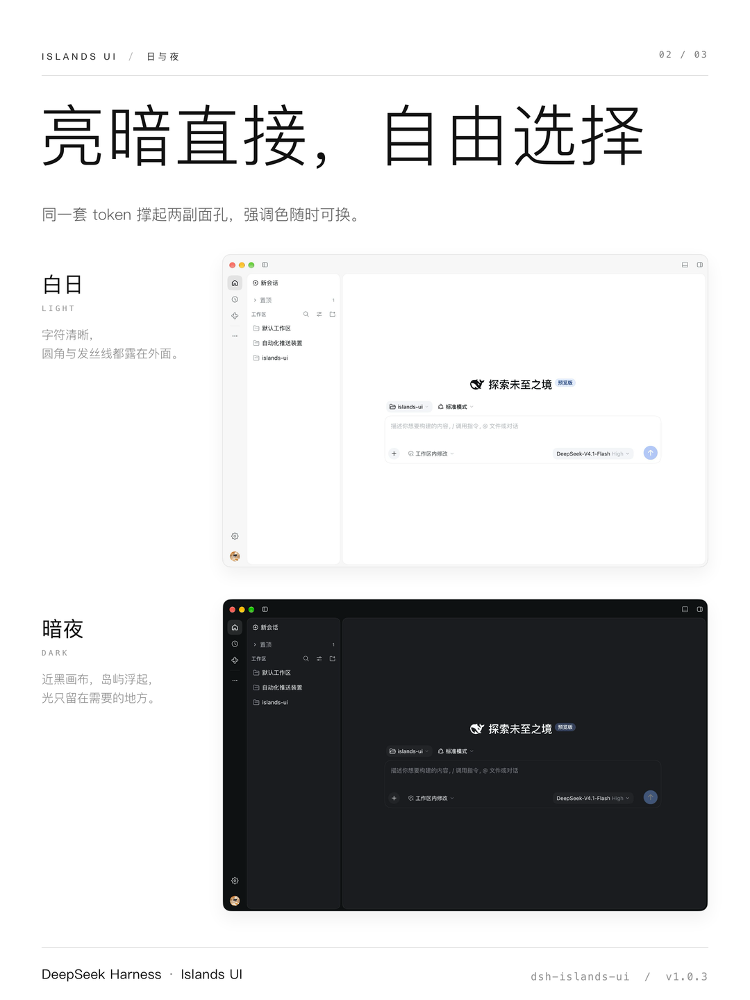
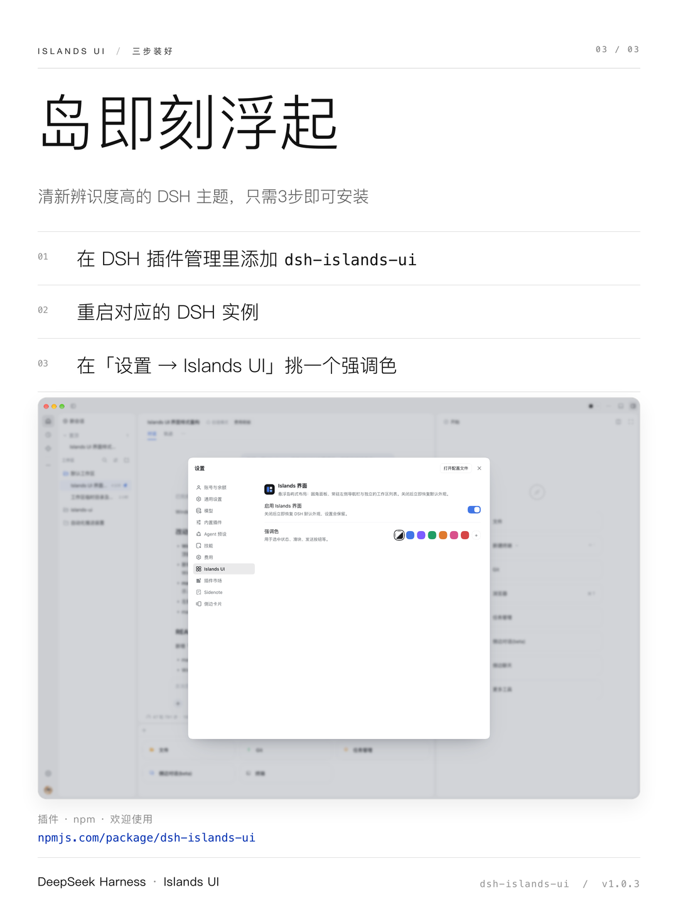
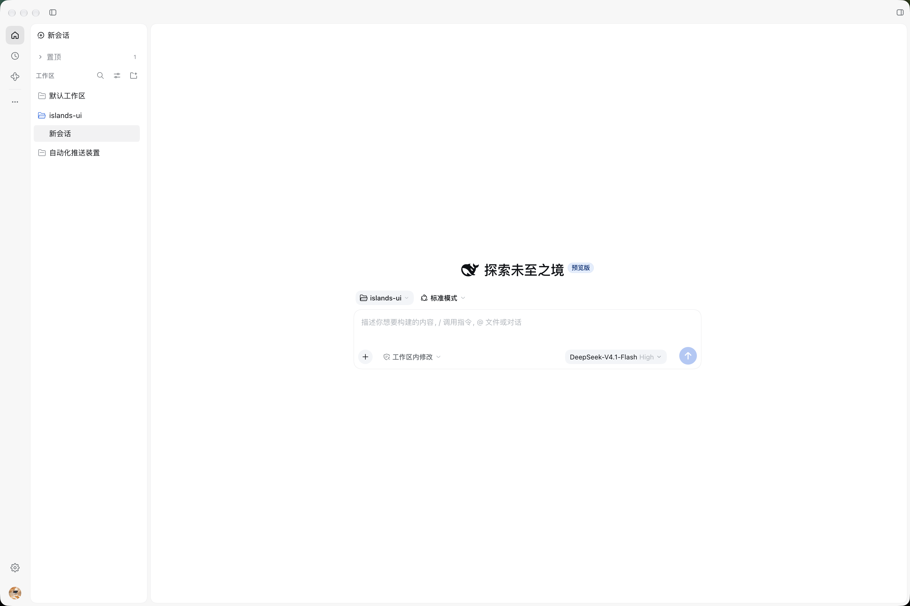
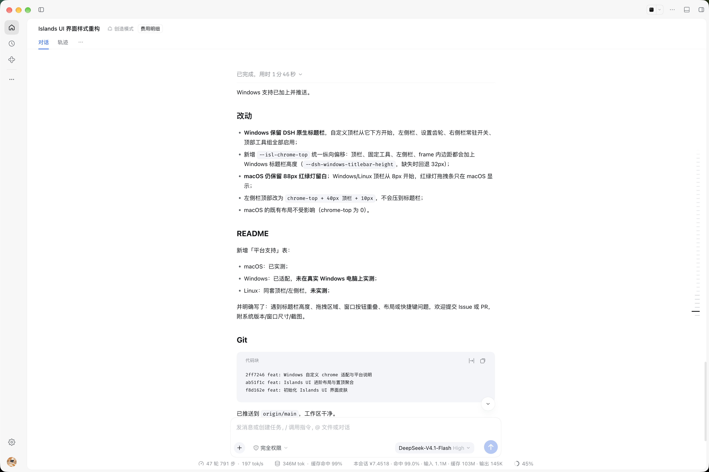
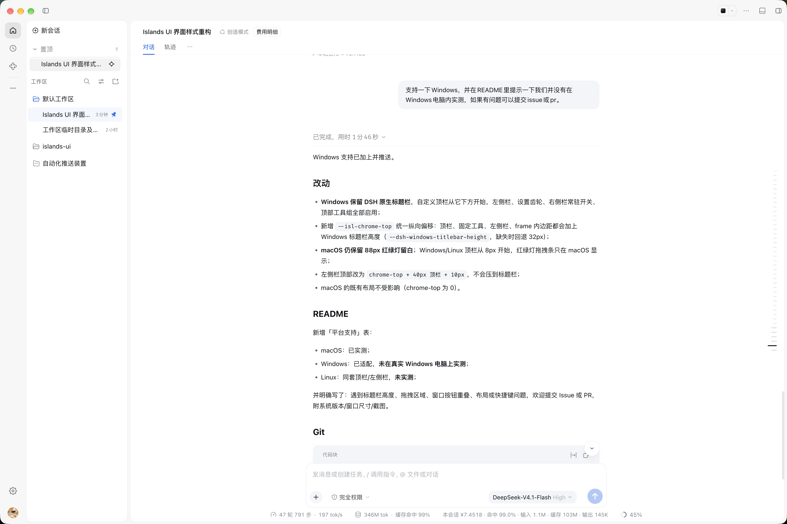
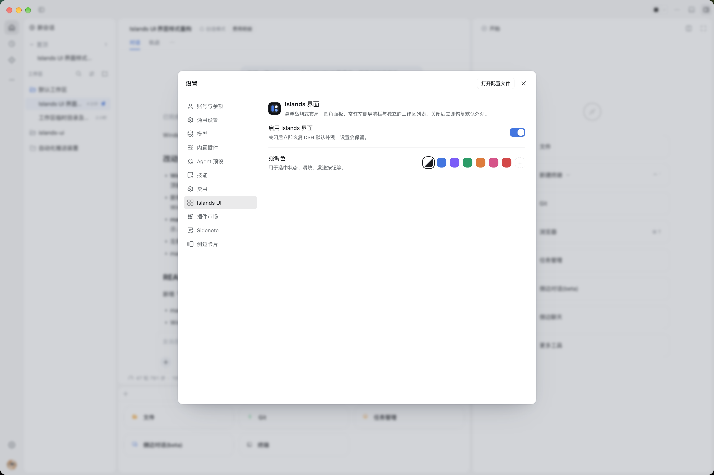

<div align="center">
  
  <h1>Islands UI</h1>
  <p><strong>A floating-island interface skin for DeepSeek Harness</strong></p>
  <p>Rounded islands · persistent rail · pinned-session shelf · adjustable accent</p>
  <p>
    <a href="https://www.npmjs.com/package/dsh-islands-ui"></a>
    <a href="https://github.com/DawnCHL/dsh-islands-ui"></a>
    <a href="https://github.com/DawnCHL/dsh-islands-ui/actions/workflows/ci.yml"></a>
    <a href="LICENSE"></a>
    
  </p>
</div>

<p align="center">
  
</p>

Islands UI reorganizes the Harness three-column shell into a set of rounded islands floating on a solid canvas: a persistent icon rail, a separate workspace list, the conversation island, a right workbench and a bottom panel, separated by 5px canvas gaps and hairline borders. It does not touch sessions, settings or plugin logic — it only redraws the interface.

---

## Install

```bash
# Desktop profile (the default app profile)
dsh plugin --profile desktop add dsh-islands-ui

# Or the web profile used by a browser/remote setup
dsh plugin --profile web add dsh-islands-ui
```

Then refresh (`⌘R` / `Ctrl+R`). The skin is enabled by default. Turn it off at **Settings → Islands UI** to restore the stock appearance immediately; your preference and accent are kept.

> Requires DeepSeek Harness `0.2.2-rc.1` or `0.2.2-rc.2`. The client reads the running release (`window.__DSH_BOOT__.release.version`) and injects the sidebar structure stylesheet for that build; older `0.2.x` builds fall back to the base stylesheet. The package declares `dsh.bundle` + `dsh.client`, so `dsh plugin add` installs and mounts it without editing the profile by hand.

### Uninstall

```bash
dsh plugin --profile desktop remove dsh-islands-ui
```

---

## What it changes

| | Feature | Details |
| :---: | --- | --- |
| 🏝 | **Floating islands** | Canvas, conversation, workspace, right sidebar and bottom panel become separate rounded surfaces; flat, no drop shadows, separated by color and a 1px hairline |
| 🧭 | **Persistent rail** | Workspace plus every plugin launcher, shown inline; the home button is a pure conversation / workspace-drawer trigger with no selected state (subtle hover and a translucent click ripple); click a panel to open it, drag to reorder with a floating preview, right-click to show or hide |
| ⚙️ | **Settings page** | Settings → Islands UI: on/off, accent presets, custom color and follow-theme |
| 📌 | **Pinned shelf** | Pinned sessions stay in their workspace and are also aggregated between “New session” and “Workspace”; the group collapses |
| 🌙 | **Dark mode** | Full dark token set: near-black canvas, dark islands, translucent interaction layers |
| 🔄 | **Desktop update entry** | Pinned above the settings gear; distinct states for available, downloading, verifying, installing and failure, with accent-colored 3×3 dot-matrix loaders |
| ⌨️ | **Shortcuts** | `⌘B`, `⌥⌘B`, `⌘,`, `⌘⇧M`; buttons show the current binding on hover |

The skin is a client-only style layer. Pinning helpers, the pinned shelf and the settings page are also implemented in the browser bundle; no host tool, service or session data is added.

---

## Design language

| Layer | Rule |
| --- | --- |
| Canvas | Solid `#f7f7f7` (dark `#0f1012`), opaque, no blur |
| Islands | White / dark-gray surfaces, 16–20px radius, 1px hairline, no shadows |
| Spacing | 5px between every island, including the bottom panel |
| Top bar | 40px window strip; macOS clears the traffic lights, Windows/Linux starts at 8px below the native title bar |
| Accent | Brand blue by default; purple / green / orange / pink / red presets or any custom color |

---

## Platform support

| Platform | Status |
| --- | --- |
| macOS | ✅ Tested |
| Windows | 🟡 Custom top bar, rail, settings gear, right-sidebar toggle and model picker adapted; **not tested on a physical Windows machine** |
| Linux | 🟡 Uses the same top bar and rail; **not tested** |

On Windows the native title bar stays in place and the custom strip sits below it; `--dsh-windows-titlebar-height` is respected. Linux follows native window decorations, which vary by desktop environment.

If you hit a title-bar, drag-region, window-button or layout issue, please open an [issue](https://github.com/DawnCHL/dsh-islands-ui/issues) with your OS version, window size and a screenshot.

---

## Key visuals

<p align="center">
  
  
  
</p>

---

## Screenshots

| New session | Workspace collapsed |
| :---: | :---: |
|  |  |
| **Pinned and reveal** | **Settings · Islands UI** |
|  |  |

---

## State

Stored in `localStorage`; clear these keys to reset:

| Key | Purpose |
| --- | --- |
| `dsh-islands-ui:enabled` | `1` / `0`, master switch |
| `dsh-islands-ui:accent` | Custom accent color; absent means follow theme |
| `dsh-islands-ui:pinned-collapsed` | Whether the pinned group is collapsed |
| `dsh-islands-ui:rail` | Left-rail icon order and hidden entries |

---

## Development

```text
src/
  00-tokens.css        design tokens + --dsw-* aliases (single source of truth)
  10-shell.css         three-column shell → canvas + islands
  15-topbar.css        window top bar
  16-rail.css          left icon rail, drag reorder, show/hide menu, settings gear
  17-update.css        desktop update entry, state styles, 3×3 dot-matrix loaders
  20-sidebar.css       workspace island, pinned shelf, session row states
  30-conversation.css  conversation page, composer, top tool group
  40-settings.css      settings dialog and section shell
  45-model-picker.css  model / reasoning popover
  50-components.css    preference rows, switches, accent picker
  60-peers.css         third-party plugin adapters ([class*=...] is allowed only here)
  host/runtime.js      host contracts, local-name extraction, part table, walker
  client.template.js   browser entry (React components + slot registrations)
build.mjs              inline src/*.css and host/runtime.js into client.js
client.js              built, self-contained artifact
scripts/check-css.mjs  selector gate
scripts/check-parts.mjs  part-table gate
scripts/check-package.mjs  pre-publish packaging checks
test/                  local-name and table-integrity tests
skin.json              theme-manager manifest
```

```bash
npm run build        # regenerate client.js after editing CSS or the template
npm run check        # verify the build is current and the package is publishable
npm run pack:check   # npm pack --dry-run
npm pack             # produce dsh-islands-ui-<version>.tgz
```

The module loader cannot read package files at runtime, so `client.js` must contain the full stylesheet. Always commit the rebuilt artifact.

### Package layout

| Path | Purpose |
| --- | --- |
| `index.js` | Host half; the skin has no host behavior, so this only keeps the bundle a valid profile row |
| `client.js` | Browser half: stylesheet injection, rail, pinned shelf, settings page and model picker |
| `cordis.patch.yml` | One `insert` row named `dsh-islands-ui` |
| `skin.json` | id, display name, accent, body attribute and wiring row for theme managers |
| `screenshots.json` | 1–8 repository-relative screenshots read by storefronts |
| `assets/` | Store icon and README screenshots |

### Repository configuration

| File | Purpose |
| --- | --- |
| `.github/workflows/ci.yml` | Runs `npm run check` and `npm pack --dry-run` on PRs / main across Node 20, 22 and 24 |
| `.github/workflows/publish.yml` | Publishes on a `v*` tag or manual dispatch; the tag must match `package.json`, and `NPM_TOKEN` is required |
| `.github/ISSUE_TEMPLATE/` | Bug and feature forms that require the DSH version, platform and reproduction steps |
| `.github/PULL_REQUEST_TEMPLATE.md` | Build, wide/narrow layout, dark mode and local-path checks |
| `.github/dependabot.yml` | Weekly GitHub Actions version updates |
| `.editorconfig` / `.gitattributes` | UTF-8, LF, 2-space indentation; images and tarballs are binary |
| `.nvmrc` | Node 24 for local development |
| `CONTRIBUTING.md` | Development, build, commit conventions and PR checklist |
| `SECURITY.md` | Supported versions and the private vulnerability-reporting flow |
| `scripts/check-package.mjs` | Pre-publish validation of the manifest, row name, client build, screenshots and `files[]` |

Repository settings: `main` requires a PR, the `check (Node 20/22/24)` CI jobs and resolved conversations, with force pushes disabled; `v*` tags cannot be deleted or moved; fork PRs from external contributors need maintainer approval.

---

## Compatibility

- The skin is a pure client style layer and does not replace session, settings or plugin data or behavior.
- Styles depend on two stable layers only: host contracts (`data-slot`, `data-phase`, `data-conversation-scroll`, `data-composer-card`, `data-row-key`, `role` / `aria-*`) and the skin's own part marks in `data-islands-part`. Host class names appear only as local names in the tables in `src/host/runtime.js`; a hash segment never enters a selector. A Harness rebuild that changes hashes needs no update, and a host rename makes the affected rule go quiet until one table line changes.
- On startup the plugin verifies the core contracts (`[data-slot="root"]`, `[data-slot="sidebar"]`) and the core parts (frame, center column, sidebar root). Only a missing core contract leaves the skin **off**; DSH keeps its default look, a toast explains why (5s auto-dismiss, manual close, click to open the plugin settings) and Settings → Islands UI carries a persistent amber notice plus a session-scoped "Enable anyway". A missing decorative part only silences its own rules.
- Settings → Islands UI shows the detected DSH release and sidebar structure (`flat` / `scroll`, inferred from the parts present) for support triage.
- Dark mode follows `data-ds-dark-theme`; the accent remaps `--dsw-alias-state-business-primary`, so it affects both the skin and native buttons.
- Windows uses `data-windows-titlebar` and `--dsh-windows-titlebar-height`; Linux currently follows native window decorations.
- `dsh.engines.dsh` / `engines.dsh` pin the tested line to `>=0.2.2-rc.1 <0.3.0-0`; outside that range the plugin manager refuses to install or upgrade. Structure drift inside the line is handled by one stylesheet keyed on the parts present, no longer by a version-selected variant. `skin.json` gives theme managers the id, accent and mount row.

---

## FAQ

**Nothing changed after install.**

Check that the plugin is enabled in the current profile and refresh (`⌘R` / `Ctrl+R`). For a local checkout, make sure `client.js` was rebuilt; for npm, compare `npm view dsh-islands-ui version` with the installed version. DSH versions below `0.2.2-rc.1` are not supported.

**Does it touch my sessions or settings?**

No. The skin injects CSS and registers browser-side slots only. Rail pins, the pinned shelf, locate state and accent live in `localStorage`; no session or profile data is written.

**How do I fully reset the skin?**

Turn off **Settings → Islands UI**. To clear the saved preferences too, delete the `dsh-islands-ui:*` localStorage keys (see [State](#state)).

**Can I run it with another theme?**

Not recommended. Two skins write the same `--dsw-*` tokens and layout rules, so the last one loaded wins. dsh-market's Themes tab enforces one active theme; if you installed several manually, keep one.

**Why do some surfaces keep the old look?**

A DSH upgrade can change a host local name or a contract. The affected rule goes quiet instead of matching a neighbour; update Islands UI, or open an issue with a screenshot and DSH version.

**Windows / Linux?**

The top bar, rail, right-panel toggle and title-bar height are adapted, but neither has been tested on a physical machine. Please report title-bar, drag-region or window-button issues using the issue template.

**Will it be in plugin stores?**

DSHHub discovers npm packages automatically. dsh-market's Themes tab reads the awesome-dsh-plugin catalog; submit the `theme` entry once the repository meets the listing requirements. See [docs/publishing.md](docs/publishing.md).

---

## Contributing and security

- Development, build, commit conventions and PR checklist: [CONTRIBUTING.md](https://github.com/DawnCHL/dsh-islands-ui/blob/main/CONTRIBUTING.md)
- Bugs / compatibility: [Issues](https://github.com/DawnCHL/dsh-islands-ui/issues)
- Improvements: PRs welcome
- Windows / Linux test reports especially welcome (screenshot + OS version + window size)
- Security issues: do not open a public issue; follow [SECURITY.md](https://github.com/DawnCHL/dsh-islands-ui/blob/main/SECURITY.md)

<p align="center"><sub>Made for DeepSeek Harness · Islands UI</sub></p>
