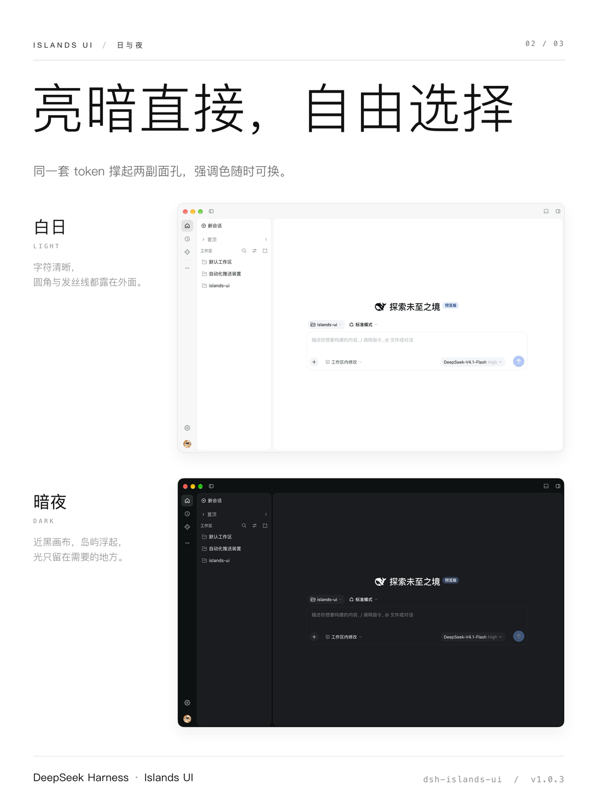
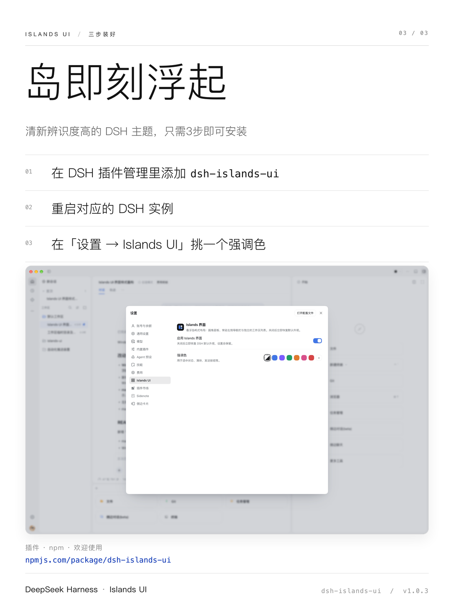
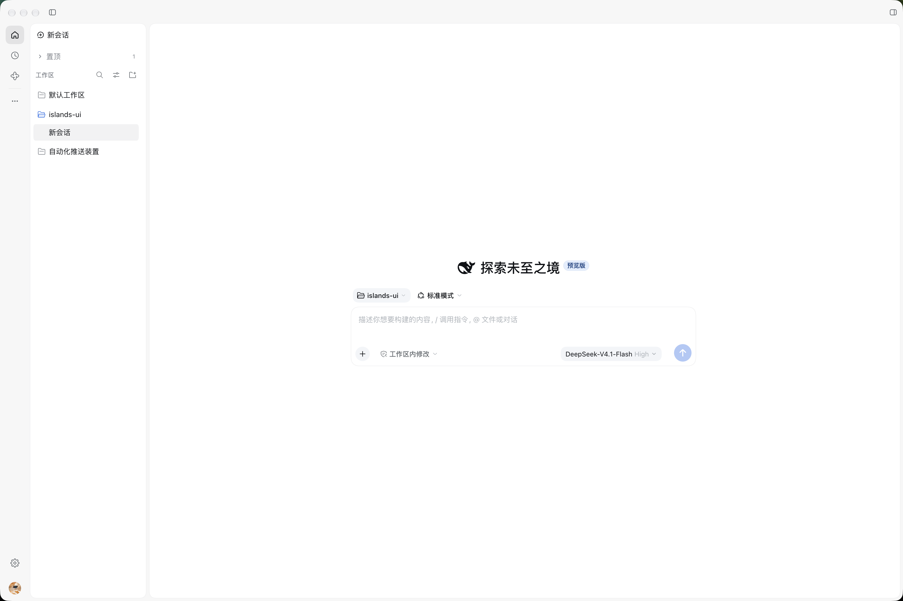
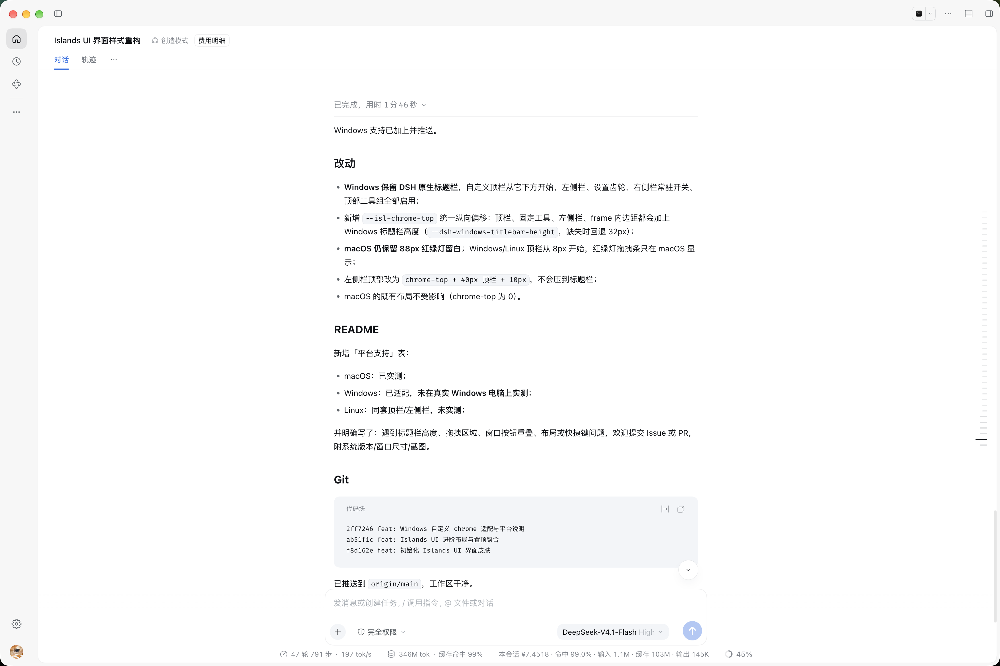
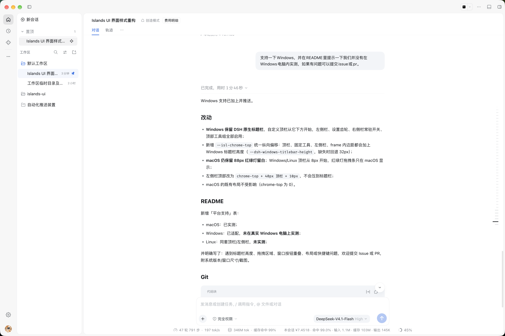
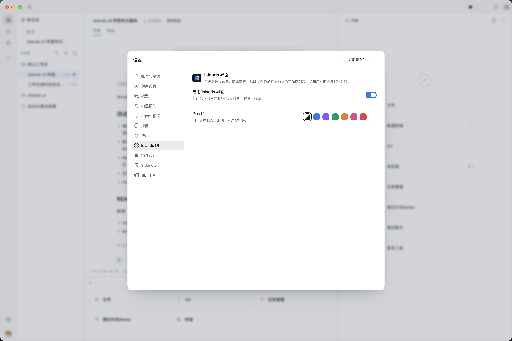

<div align="center">
  
  <h1>Islands UI</h1>
  <p><strong>A floating-island interface skin for DeepSeek Harness</strong></p>
  <p>Rounded islands · persistent rail · pinned-session shelf · adjustable accent</p>
  <p>
    <a href="https://www.npmjs.com/package/dsh-islands-ui"></a>
    <a href="https://www.npmjs.com/package/dsh-islands-ui"></a>
    <a href="https://github.com/DawnCHL/dsh-islands-ui"></a>
    <a href="LICENSE"></a>
    
    
  </p>
</div>

<p align="center">
  
</p>

Islands UI reorganizes the Harness three-column shell into a set of rounded islands floating on a solid canvas: a persistent icon rail, a separate workspace list, the conversation island, a right workbench and a bottom panel, separated by 5px canvas gaps and hairline borders. It does not touch sessions, settings or plugin logic — it only redraws the interface.

---

## Install

```bash
# Desktop profile (the default app profile)
dsh plugin --profile desktop add dsh-islands-ui

# Or the web profile used by a browser/remote setup
dsh plugin --profile web add dsh-islands-ui
```

Then refresh (`⌘R` / `Ctrl+R`). The skin is enabled by default. Turn it off at **Settings → Islands UI** to restore the stock appearance immediately; your preference and accent are kept.

> Supports DeepSeek Harness `0.2.2-rc.1`, `0.2.2-rc.2` and `0.2.2-rc.3`; older versions do not load. If a DSH upgrade changes the interface structure, the skin may disable itself with a notice — update the plugin and refresh.

Offline or manual install from a local package:

```bash
dsh plugin --profile desktop add ./dsh-islands-ui-<version>.tgz
```

### Update

Run the install command again, or update from the plugin store, then refresh. If the CLI reports that the plugin is already installed, remove it first and add it again.

### Uninstall

```bash
dsh plugin --profile desktop remove dsh-islands-ui
```

Refresh after uninstalling. Your skin preferences stay on this machine and are reused if you reinstall.

---

## What it changes

| | Feature | Details |
| :---: | --- | --- |
| 🏝 | **Floating islands** | Canvas, conversation, workspace, right sidebar and bottom panel become separate rounded surfaces; flat, no drop shadows, separated by color and a 1px hairline |
| 🧭 | **Persistent rail** | Workspace plus every plugin launcher, shown inline; the home button is a pure conversation / workspace-drawer trigger with no selected state (subtle hover and a translucent click ripple); click a panel to open it, drag to reorder with a floating preview, right-click to show or hide; hovering an icon floats its name to the right in a dark pill that follows the light / dark theme |
| ⚙️ | **Settings page** | Settings → Islands UI: on/off, accent presets, custom color, follow-theme and the smooth input caret |
| 📌 | **Pinned shelf** | Pinned sessions stay in their workspace and are also aggregated between “New session” and “Workspace”; the group collapses |
| 🌙 | **Dark mode** | Full dark palette: near-black canvas, dark islands, translucent interaction layers |
| 🔄 | **Desktop update entry** | Pinned above the settings gear; distinct states for available, downloading, verifying, installing and failure, with accent-colored 3×3 dot-matrix loaders |
| ⌨️ | **Shortcuts** | `⌘B`, `⌥⌘B`, `⌘,`, `⌘⇧M`; buttons show the current binding on hover |

Everything happens in the interface layer. Rail ordering, the pinned shelf and the settings page do not modify your Harness sessions, settings or plugin data.

---

## Design language

| Layer | Rule |
| --- | --- |
| Canvas | Solid `#f7f7f7` (dark `#0f1012`), opaque, no blur |
| Islands | White / dark-gray surfaces, 16–20px radius, 1px hairline, no shadows |
| Spacing | 5px between every island, including the bottom panel |
| Top bar | 40px window strip hosting the conversation tools and the right-panel toggle; macOS clears the traffic lights, Linux starts at 8px below the native title bar. Windows renders no island top bar: the caption row keeps the native sidebar toggle and the right-hand tools stay in the conversation header |
| Accent | Brand blue by default; purple / green / orange / pink / red presets or any custom color |
| Caret | The conversation composer uses a smooth caret: it glides along a line, jumps to the next one, and follows the accent color; it can be turned off in settings |

---

## Platform support

| Platform | Status |
| --- | --- |
| macOS | ✅ Tested |
| Windows | ✅ Tested (native title bar layout) |
| Linux | 🟡 Native window decorations, not tested |

Windows uses DSH's native title bar instead of the plugin's 40px top bar; the workspace collapses from the native sidebar button in the top-left corner, while the right-panel toggle and conversation tools stay in DSH's native conversation header. macOS and Linux use the 40px top bar; Linux window decorations vary by desktop environment.

When reporting an issue, please include your OS, DSH version, window size and a screenshot.

---

## Key visuals

<p align="center">
  
  
  
</p>

---

## Screenshots

| New session | Workspace collapsed |
| :---: | :---: |
|  |  |
| **Pinned and reveal** | **Settings · Islands UI** |
|  |  |

---

## Data and privacy

The skin only redraws the interface. It does not modify or upload your sessions, settings or plugin data.

The master switch, accent, smooth-caret switch, pinned-group state and rail order are stored in your browser's local storage. Turning the skin off keeps these preferences; to reset them, restore the defaults in Settings or clear the site's local storage.

---

## Compatibility

- Supports DSH `0.2.2-rc.1`, `0.2.2-rc.2` and `0.2.2-rc.3`; older versions do not load.
- If a DSH upgrade changes key interface structure, the skin disables itself with a notice. Update Islands UI and refresh to recover; you can temporarily re-enable it from **Settings → Islands UI** while the interface looks correct.
- Dark mode follows DSH; the accent applies to both the skin and native buttons.
- Do not enable multiple themes or skins at once: they change the same palette and layout rules, so the last one loaded wins.
- Windows uses the native title bar; Linux uses native window decorations, which vary by desktop environment.

---

## FAQ

**Nothing changed after install.**

Check that the plugin is enabled in the current DSH profile and refresh (`⌘R` / `Ctrl+R`). If your DSH is older than `0.2.2-rc.1`, upgrade DSH first; you can also check the skin status in **Settings → Islands UI**.

**Does it touch my sessions or settings?**

No. The skin only redraws the interface; the master switch, accent, smooth-caret switch, pinned-group state and rail order live in your browser's local storage.

**How do I fully reset the skin?**

Turn it off in **Settings → Islands UI** to restore the stock appearance immediately. To reset the saved preferences too, clear the site's local storage.

**Can I run it with another theme?**

Not recommended. Multiple skins change the same palette and layout rules, so the last one loaded wins.

**Why do some surfaces keep the old look?**

A DSH upgrade may change the interface structure. If the skin detects a key mismatch, it disables itself to avoid overlapping layouts. Update Islands UI to a version that supports your DSH and refresh; if the interface looks correct, you can also click "Enable anyway" in Settings for the current session (it re-checks on the next launch).

**Windows / Linux?**

Windows is tested with the native title bar layout. Linux follows native window decorations and has not been tested yet. Please report title-bar, drag-region or window-button issues with your system details.

---

## Feedback

- Bugs or compatibility issues: [open an issue](https://github.com/DawnCHL/dsh-islands-ui/issues)
- Include your OS, DSH version, window size and a screenshot.
- Feature requests are welcome in Issues too.
- Security issues: do not open a public issue; report privately following [SECURITY.md](https://github.com/DawnCHL/dsh-islands-ui/blob/main/SECURITY.md).

## License

[MIT](LICENSE) © DawnCHL

<p align="center"><sub>Made for DeepSeek Harness · Islands UI</sub></p>
