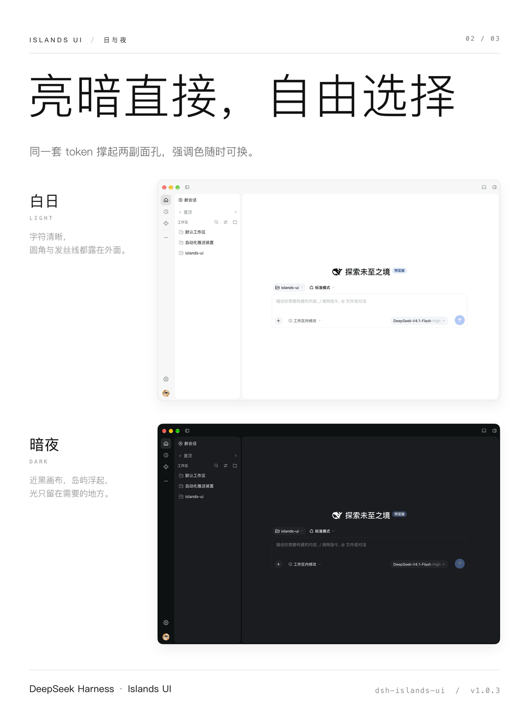
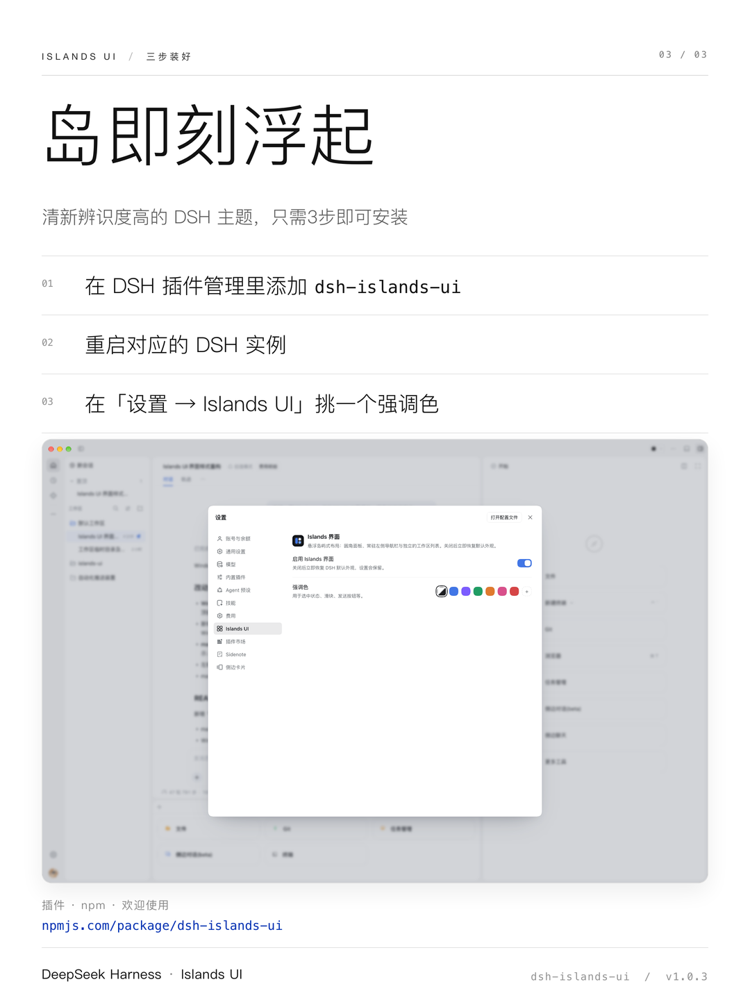
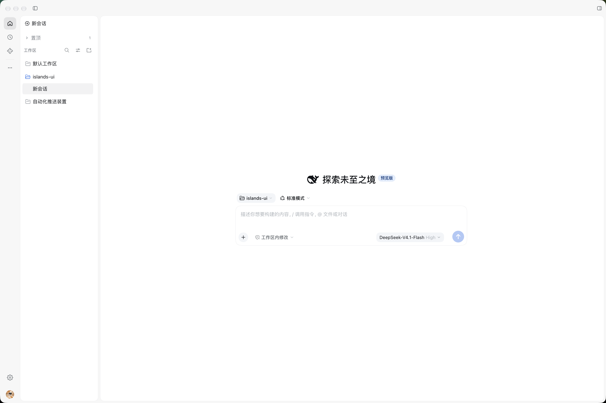
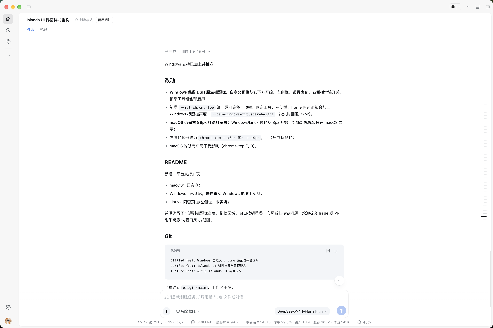
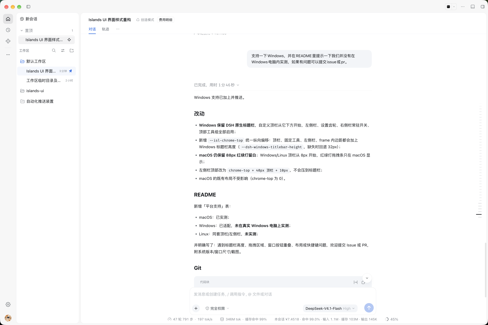
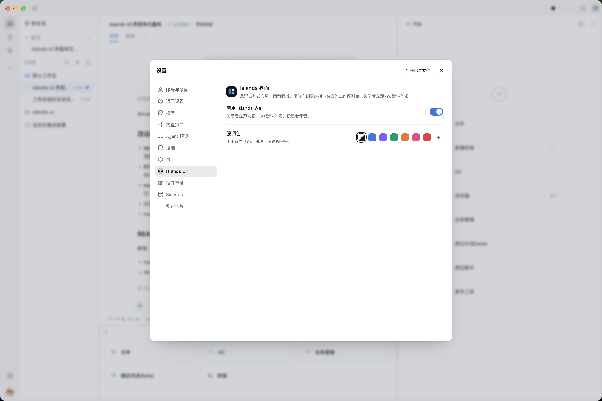

<div align="center">
  
  <h1>Islands UI</h1>
  <p><strong>为 DeepSeek Harness 打造的浮岛式界面皮肤</strong></p>
  <p>圆角岛屿 · 常驻左侧栏 · 置顶聚合 · 可调强调色</p>
  <p>
    <a href="https://www.npmjs.com/package/dsh-islands-ui"></a>
    <a href="https://www.npmjs.com/package/dsh-islands-ui"></a>
    <a href="https://github.com/DawnCHL/dsh-islands-ui"></a>
    <a href="LICENSE"></a>
    
    
  </p>
</div>

<p align="center">
  
</p>

Islands UI 把 Harness 的三栏界面重新组织成一组悬浮在纯色画布上的圆角岛屿：左侧常驻图标栏、独立的工作区列表、主会话区、右侧工作台和底部面板各自成块，用 5px 的画布间隙与发丝描边分层。它不修改 Harness 的会话、设置或插件逻辑，只重绘界面。

---

## 安装

```bash
# 桌面端默认 profile
dsh plugin --profile desktop add dsh-islands-ui

# 浏览器 / 远程场景使用的 web profile
dsh plugin --profile web add dsh-islands-ui
```

安装后刷新页面（`⌘R` / `Ctrl+R`）。皮肤默认开启；可在 **设置 → Islands UI** 关闭，关闭后立即恢复 Harness 默认外观，偏好和强调色会保留。

> 支持 DSH `0.2.2-rc.1`、`0.2.2-rc.2` 与 `0.2.2-rc.3`；更低版本不会加载。DSH 升级后如果界面结构发生变化，皮肤可能自动停用并提示，更新插件后刷新即可恢复。

离线或手动安装本地包：

```bash
dsh plugin --profile desktop add ./dsh-islands-ui-<version>.tgz
```

### 更新

重新执行安装命令，或从插件商店更新，然后刷新页面。如果提示已安装，可先卸载再安装。

### 卸载

```bash
dsh plugin --profile desktop remove dsh-islands-ui
```

卸载后刷新页面；皮肤偏好仍保存在本机，重新安装会沿用。

---

## 宣传图

<p align="center">
  
  
  
</p>

---

## 界面预览

| 新会话 | 工作区折叠 |
| :---: | :---: |
|  |  |
| **置顶与定位** | **设置 · Islands UI** |
|  |  |

---

## 功能

| | 功能 | 说明 |
| :---: | --- | --- |
| 🏝 | **浮岛布局** | 画布、主会话、工作区、右侧栏、底部面板各自独立；扁平无投影，以色块 + 1px 发丝线分隔 |
| 🧭 | **常驻左侧栏** | 工作区与全部插件图标直接排列；首页按钮只作会话 / 工作区抽屉触发器、不占选中态（hover 浅色反馈、点击半透明涟漪）；面板图标点击切换，按住拖动排序（浮动预览跟随鼠标），右键显示 / 隐藏图标 |
| ⚙️ | **独立设置页** | 设置 → Islands UI：一键开关皮肤、强调色（预设 + 自定义 + 跟随主题） |
| 📌 | **置顶聚合** | 置顶会话同时保留在原工作区，并聚合到「新会话」与「工作区」标题之间；分类可折叠 |
| 🌙 | **深色模式** | 完整深色配色：近黑画布、深灰岛屿、白色透明交互层与深色阴影 |
| 🔄 | **桌面更新入口** | 设置齿轮上方常驻；发现新版本、下载、校验、安装与失败各有独立状态，加载态使用强调色 3×3 点阵动效 |
| ⌨️ | **快捷键** | `⌘B` 折叠工作区、`⌥⌘B` 右侧栏、`⌘,` 设置、`⌘⇧M` 模型弹层；按钮悬停显示当前键位 |

所有改动都在界面层完成；左侧栏图标排序与显隐、置顶聚合、定位和设置页不会修改 Harness 的会话、设置或插件数据。

### 设计语言

| 层级 | 规则 |
| --- | --- |
| 画布 | 纯色 `#f7f7f7`（深色 `#0f1012`），不透明、无毛玻璃 |
| 岛屿 | 白色 / 深灰表面，16–20px 圆角，1px 发丝描边，无投影 |
| 间距 | 所有岛屿统一 5px 间隙，左右、顶部、底部、底部面板四周一致 |
| 顶部栏 | 40px 窗口栏，承载对话工具组和右侧栏开关；macOS 避开红绿灯，Linux 从 8px 开始。Windows 不渲染该顶栏：标题栏保留原生侧栏开关，右侧工具回到会话头原生位置 |
| 强调色 | 默认品牌蓝，可改为紫 / 绿 / 橙 / 粉 / 红或任意取色 |

### 常用快捷键

| 快捷键 | 功能 |
| --- | --- |
| `⌘B` / `Ctrl+B` | 折叠 / 展开工作区 |
| `⌥⌘B` / `Ctrl+Alt+B` | 打开 / 关闭右侧栏 |
| `⌘,` / `Ctrl+,` | 打开设置 |
| `⌘⇧M` / `Ctrl+Shift+M` | 打开模型 / 推理弹层 |
| `⌘N` / `Ctrl+N` | 新会话 |
| `⌘K` / `Ctrl+K` | 搜索会话 |
| `⌘/` / `Ctrl+/` | 快捷键向导 |

> 快捷键沿用 Harness 的绑定系统，可在「设置 → 快捷键」里重新绑定；悬停对应按钮会显示当前键位。

---

## 平台支持

| 平台 | 状态 |
| --- | --- |
| macOS | ✅ 已实测 |
| Windows | ✅ 已实测（原生标题栏布局） |
| Linux | 🟡 按原生窗口装饰适配，尚未实测 |

Windows 使用 DSH 原生标题栏，不渲染插件的 40px 顶栏；工作区折叠由标题栏左上角的原生侧栏按钮控制，右侧栏开关与会话工具留在 DSH 原生会话头位置。macOS / Linux 使用同一套 40px 顶栏；Linux 的窗口装饰因桌面环境而异。

> 反馈时请附上系统版本、DSH 版本、窗口尺寸和截图，方便定位问题。

---

## 数据与隐私

皮肤只重绘界面，不会修改或上传你的会话、设置或插件数据。

总开关、强调色、置顶折叠和左侧栏顺序保存在本机浏览器存储中；关闭皮肤不会删除这些偏好。需要重置时，可在设置中改回默认，或清除该站点的本地存储。

---

## 兼容性

- 支持 DSH `0.2.2-rc.1`、`0.2.2-rc.2` 与 `0.2.2-rc.3`；更低版本不会加载。
- 如果 DSH 升级改变了关键界面结构，皮肤会自动停用并提示；更新 Islands UI 后刷新页面即可恢复。确认界面正常时，可在 **设置 → Islands UI** 临时重新启用。
- 深色模式跟随 DSH；强调色会同时作用于皮肤和原生按钮。
- 不建议同时启用多个主题/皮肤：它们会修改同一批界面配色和布局规则，后加载的会覆盖先加载的。
- Windows 使用原生标题栏；Linux 使用原生窗口装饰，不同桌面环境的表现可能有差异。

---

## 常见问题

**安装后没有变化？**

先确认当前 DSH 配置（profile）中插件已启用，并刷新页面（`⌘R` / `Ctrl+R`）。如果 DSH 版本低于 `0.2.2-rc.1`，请先升级 DSH；也可以到 **设置 → Islands UI** 查看皮肤状态。

**会修改我的会话、设置或插件数据吗？**

不会。皮肤只重绘界面；总开关、强调色、置顶折叠和左侧栏顺序保存在本机浏览器存储中。

**怎么彻底恢复默认外观？**

在 **设置 → Islands UI** 关闭总开关即可立即恢复。需要连偏好一起重置时，清除该站点的本地存储。

**可以和别的主题/皮肤同时开吗？**

不建议。多个皮肤会同时修改同一批界面配色和布局规则，后加载的会覆盖前一个。

**为什么某些界面还是旧样式？**

DSH 升级可能改变界面结构；皮肤检测到关键界面不匹配时会自动停用，避免出现双栏重叠。更新 Islands UI 到适配当前 DSH 的版本后刷新即可恢复；确认界面正常时，也可以在设置页点「仍然启用」临时开启（下次启动会重新检测）。

**Windows / Linux 能用吗？**

Windows 已实测，使用原生标题栏布局；Linux 按原生窗口装饰适配，尚未实测。遇到标题栏、拖拽区或窗口按钮问题，欢迎反馈。

---

## 反馈

- 遇到 Bug 或兼容性问题：[提交 Issue](https://github.com/DawnCHL/dsh-islands-ui/issues)
- 反馈时请附上系统版本、DSH 版本、窗口尺寸和截图。
- 功能建议也欢迎在 Issues 中提出。
- 安全漏洞：请不要开公开 Issue，按 [SECURITY.md](https://github.com/DawnCHL/dsh-islands-ui/blob/main/SECURITY.md) 私密报告。

## License

[MIT](LICENSE) © DawnCHL

<p align="center"><sub>Made for DeepSeek Harness · Islands UI</sub></p>
