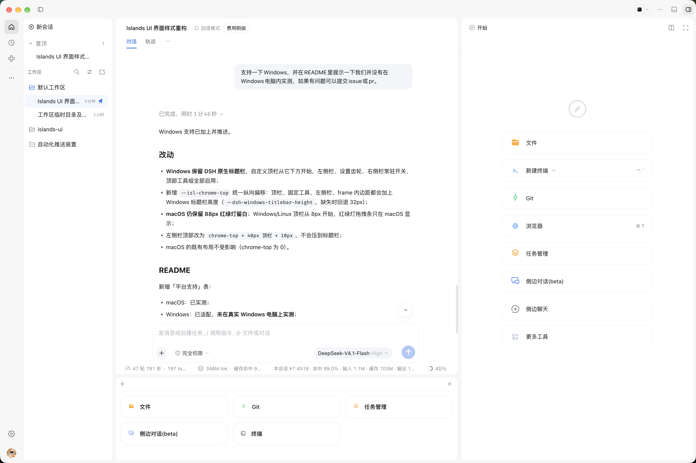
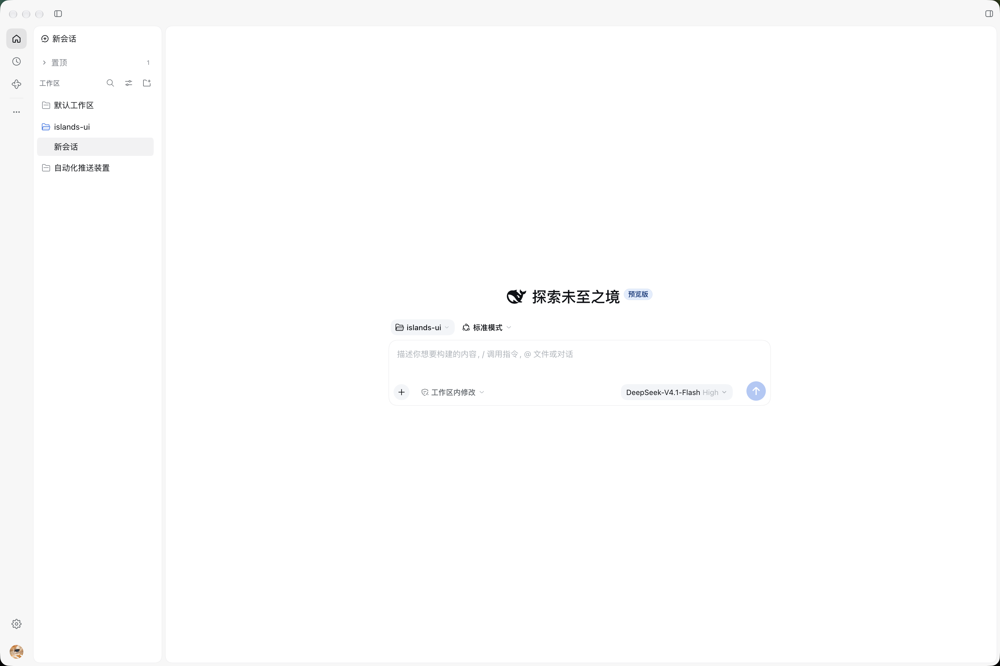
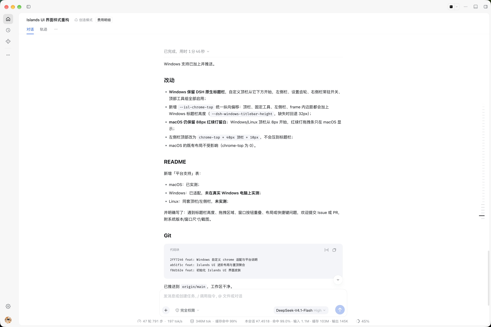
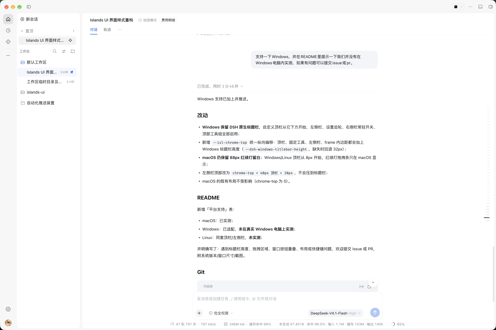
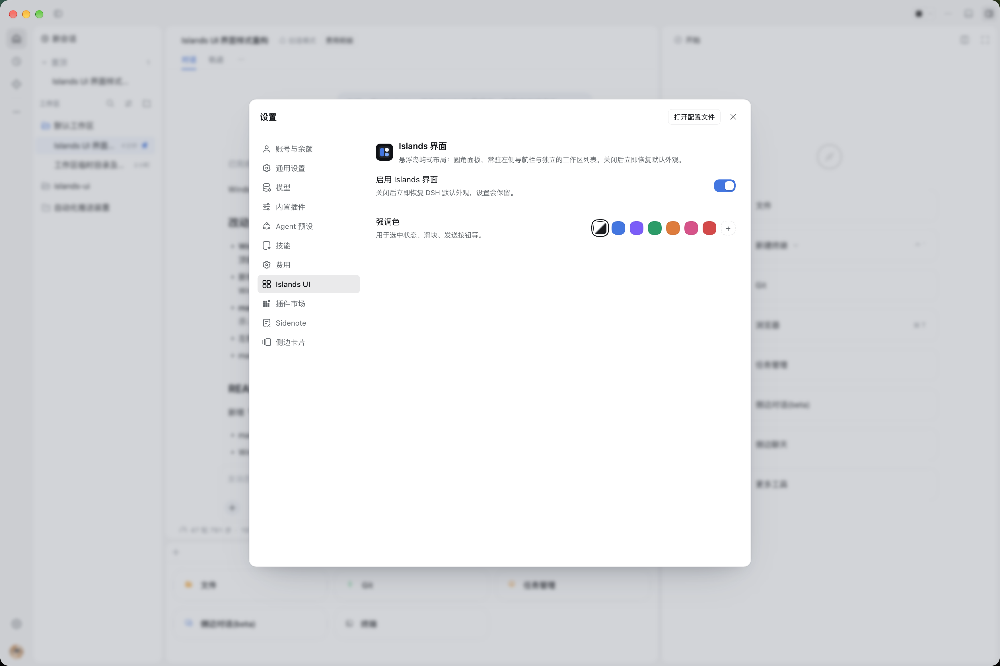

<div align="center">
  
  <h1>Islands UI</h1>
  <p><strong>为 DeepSeek Harness 打造的浮岛式界面皮肤</strong></p>
  <p>圆角岛屿 · 常驻左侧栏 · 置顶聚合 · 可调强调色</p>
  <p>
    <a href="https://www.npmjs.com/package/dsh-islands-ui"></a>
    <a href="https://www.npmjs.com/package/dsh-islands-ui"></a>
    <a href="https://github.com/DawnCHL/dsh-islands-ui"></a>
    <a href="https://github.com/DawnCHL/dsh-islands-ui/actions/workflows/ci.yml"></a>
    <a href="LICENSE"></a>
    
    
    
  </p>
</div>

<p align="center">
  
</p>

Islands UI 把 Harness 的三栏界面重新组织成一组悬浮在纯色画布上的圆角岛屿：左侧常驻图标栏、独立的工作区列表、主会话区、右侧工作台和底部面板各自成块，用 5px 的画布间隙与发丝描边分层。它不修改 Harness 的会话、设置或插件逻辑，只重绘界面。

---

## 安装

```bash
# 桌面端默认 profile
dsh plugin --profile desktop add dsh-islands-ui

# 浏览器 / 远程场景使用的 web profile
dsh plugin --profile web add dsh-islands-ui
```

安装后刷新页面（`⌘R` / `Ctrl+R`）。皮肤默认开启；可在 **设置 → Islands UI** 关闭，关闭后立即恢复 Harness 默认外观，偏好和强调色会保留。

> 适用于 DSH `0.2.2-rc.1` 及 `0.2.x` 后续版本。包内声明了完整的 `dsh.bundle` + `dsh.client` manifest，`dsh plugin add` 会自动写入 profile 的 bundle 栈，不需要手工改 `cordis.patch.yml`。

### 卸载

```bash
dsh plugin --profile desktop remove dsh-islands-ui
```

---

## 界面预览

| 新会话 | 工作区折叠 |
| :---: | :---: |
|  |  |
| **置顶与定位** | **设置 · Islands UI** |
|  |  |

---

## 功能

| | 功能 | 说明 |
| :---: | --- | --- |
| 🏝 | **浮岛布局** | 画布、主会话、工作区、右侧栏、底部面板各自独立；扁平无投影，以色块 + 1px 发丝线分隔 |
| 🧭 | **常驻左侧栏** | 工作区 / 自动化任务 / 插件 / 已固定插件 / 更多；右键或「…」打开插件固定菜单 |
| ⚙️ | **独立设置页** | 设置 → Islands UI：一键开关皮肤、强调色（预设 + 自定义 + 跟随主题） |
| 📌 | **置顶聚合** | 置顶会话同时保留在原工作区，并聚合到「新会话」与「工作区」标题之间；分类可折叠 |
| 🌙 | **深色模式** | 完整深色 token：近黑画布、深灰岛屿、白色透明交互层与深色阴影 |
| ⌨️ | **快捷键** | `⌘B` 折叠工作区、`⌥⌘B` 右侧栏、`⌘,` 设置、`⌘⇧M` 模型弹层；按钮悬停显示当前键位 |

皮肤是纯客户端样式层；左侧栏插件固定、置顶聚合、定位与设置页也都在浏览器端完成，不新增 host 工具、服务或会话数据。

### 设计语言

| 层级 | 规则 |
| --- | --- |
| 画布 | 纯色 `#f7f7f7`（深色 `#0f1012`），不透明、无毛玻璃 |
| 岛屿 | 白色 / 深灰表面，16–20px 圆角，1px 发丝描边，无投影 |
| 间距 | 所有岛屿统一 5px 间隙，左右、顶部、底部、底部面板四周一致 |
| 顶部栏 | 40px 窗口栏，承载工作区折叠、对话工具组和右侧栏开关；macOS 避开红绿灯，Windows/Linux 从 8px 开始 |
| 强调色 | 默认品牌蓝，可改为紫 / 绿 / 橙 / 粉 / 红或任意取色 |

### 常用快捷键

| 快捷键 | 功能 |
| --- | --- |
| `⌘B` / `Ctrl+B` | 折叠 / 展开工作区 |
| `⌥⌘B` / `Ctrl+Alt+B` | 打开 / 关闭右侧栏 |
| `⌘,` / `Ctrl+,` | 打开设置 |
| `⌘⇧M` / `Ctrl+Shift+M` | 打开模型 / 推理弹层 |
| `⌘N` / `Ctrl+N` | 新会话 |
| `⌘K` / `Ctrl+K` | 搜索会话 |
| `⌘/` / `Ctrl+/` | 快捷键向导 |

> 快捷键沿用 Harness 的绑定系统，可在「设置 → 快捷键」里重新绑定；悬停对应按钮会显示当前键位。

---

## 平台支持

| 平台 | 状态 |
| --- | --- |
| macOS | ✅ 已实测（开发与日常使用环境） |
| Windows | 🟡 已适配自定义顶栏、左侧栏、设置齿轮、右侧开关、置顶聚合与模型弹层，并在原生标题栏下方预留高度；**尚未在真实 Windows 电脑上实测** |
| Linux | 🟡 使用同一套顶栏与左侧栏；**尚未实测** |

Windows 下保留 Harness 原生标题栏，自定义顶栏显示在它下方；左侧栏、设置齿轮、右侧栏开关和快捷键均已启用。Linux 按原生窗口装饰处理，不同桌面环境可能有差异。

> **反馈**：如果你在 Windows 或 Linux 上遇到标题栏高度、拖拽区域、窗口按钮重叠、布局错位或快捷键问题，欢迎提交 [Issue](https://github.com/DawnCHL/dsh-islands-ui/issues) 或 PR，附系统版本、窗口尺寸和截图即可。

---

## 状态存储

| `localStorage` key | 作用 |
| --- | --- |
| `dsh-islands-ui:enabled` | `1` / `0`，总开关 |
| `dsh-islands-ui:accent` | 自定义强调色（不存在表示跟随主题） |
| `dsh-islands-ui:pinned-collapsed` | 置顶分类是否折叠 |
| `dsh-islands-ui:rail-pins` | 左侧栏额外固定的插件 id 列表 |

清除这些 key 即可恢复默认。

---

## 开发

```text
src/
  00-tokens.css        设计变量 + 重定向 Harness 的 --dsw-* 别名（唯一真源）
  10-shell.css         三栏框架 → 画布 + 岛屿
  15-topbar.css        窗口顶部栏
  16-rail.css          左侧图标栏、插件固定菜单、设置齿轮
  20-sidebar.css       工作区岛屿、置顶聚合、会话行状态
  30-conversation.css  会话页、输入框、顶部工具组
  40-settings.css      设置弹窗、设置页外壳
  45-model-picker.css  模型/推理两级弹层
  50-components.css    偏好行、开关、强调色选择器等共享组件
  client.template.js   浏览器端入口模板（React 组件 + 插槽注册）
build.mjs              把 src/*.css 内联进 client.js
client.js              构建产物（自包含，运行时无法读文件）
scripts/check-package.mjs  发布前包内容校验
skin.json              主题管理器清单
docs/                  发布与商店收录说明
```

```bash
npm run build        # 修改 src/*.css 或模板后重新生成 client.js
npm run check        # 校验 client.js 是否为最新，并检查 npm 包是否可发布
npm run pack:check   # npm pack --dry-run
npm pack             # 生成 dsh-islands-ui-<version>.tgz
```

开发时直接在 Harness 中刷新（`⌘R`）即可；`client.js` 是自包含的浏览器模块，样式在加载时注入。模块加载器运行时无法读取包内文件，因此修改 CSS 后必须重新构建并提交 `client.js`。

### 包内容

| 路径 | 作用 |
| --- | --- |
| `index.js` | host 半边；皮肤没有 host 行为，仅用于保持合法的 profile row |
| `client.js` | 浏览器半边：样式注入、左侧栏、置顶聚合、设置页与模型弹层 |
| `cordis.patch.yml` | 一条 `insert`，row name 为 `dsh-islands-ui` |
| `skin.json` | 给主题管理器的 id、名称、强调色、body 属性与挂载行 |
| `screenshots.json` | 商店读取的 1–8 张仓库相对路径截图 |
| `assets/` | 商店图标与 README 截图 |

### 仓库配置

| 文件 | 作用 |
| --- | --- |
| `.github/workflows/ci.yml` | PR / main 上跑 `npm run check` 和 `npm pack --dry-run`，Node 20 / 22 / 24 矩阵 |
| `.github/workflows/publish.yml` | 推送 `v*` tag 或手动触发发布；tag 必须与 `package.json` 版本一致，使用 `NPM_TOKEN` secret |
| `.github/ISSUE_TEMPLATE/` | Bug / Feature 表单，强制填写 DSH 版本、平台和复现步骤 |
| `.github/PULL_REQUEST_TEMPLATE.md` | PR 自检：构建、宽窄屏、深色模式、无本地路径 |
| `.github/dependabot.yml` | 每周检查 GitHub Actions 版本更新 |
| `.editorconfig` / `.gitattributes` | 统一 UTF-8、LF、2 空格；图片和 tarball 按二进制处理 |
| `.nvmrc` | 本地开发使用 Node 24 |
| `CONTRIBUTING.md` | 开发、构建、提交约定和 PR 清单 |
| `SECURITY.md` | 支持版本与私密漏洞报告流程 |
| `scripts/check-package.mjs` | 包里 manifest、row name、client 构建、截图和 `files[]` 的发布前校验 |

仓库设置：`main` 需要 PR、CI 的 `check (Node 20/22/24)` 通过和对话解决后才能合并，且禁止 force push；`v*` tag 禁止删除/移动；外部 fork PR 需要维护者批准。

---

## 发布与商店

完整步骤见 [docs/publishing.md](docs/publishing.md)。最短路径：

```bash
npm login
npm run check
npm publish --access public
```

`publishConfig.registry` 已显式指向 `https://registry.npmjs.org/`，避免本机 npm 镜像（如 `registry.npmmirror.com`）把发布吞掉。

商店覆盖：

- **npm** — 安装源；包名 [`dsh-islands-ui`](https://www.npmjs.com/package/dsh-islands-ui)，用 `npm view dsh-islands-ui version` 确认线上版本
- **DSHHub** — 自动发现带合法 `dsh.bundle` manifest 的 npm 包，发布后无需额外操作；可在 Hub 用 GitHub App 认领条目
- **awesome-dsh-plugin / dsh-market** — 用 [docs/awesome-dsh-plugin.yml](docs/awesome-dsh-plugin.yml) 里的 `theme` 条目提 PR；合并后 dsh-market 的「主题」Tab 会自动收录
- **dsh-market** — 直接读取 awesome-dsh-plugin 的 `theme` 分类

> awesome-dsh-plugin 要求仓库创建满 **1 天**、带 `dsh-plugin` topic，并且根 `package.json` 声明 `dsh.bundle`。先完成 npm 发布，满足仓库年龄要求后再提交 `theme` 条目，避免被 CI 打回。

---

## 兼容性与边界

- 皮肤是**纯客户端样式层**，不替换会话、设置或插件的数据与交互；左侧栏插件固定、置顶聚合、定位等额外能力也只在客户端完成。
- 选择器依赖 Harness 当前构建的 CSS Module 哈希类名（如 `PIRFFq_*`、`kB3qhq_*`、`JoiKIa_*`、`_77Pn0W_*`）与少量 `data-*` 挂点；**Harness 升级或重新构建后类名可能变化，需要同步更新对应 CSS**。
- 启动时会检测三个界面锚点（`.PIRFFq_frame`、`.PIRFFq_centerCol`、`.kB3qhq_root`）：缺失就**不启用皮肤**，DSH 保持默认外观，右下角弹出说明（5 秒自动关闭、可手动关闭、点击进入插件设置），设置 → Islands UI 里也常驻一条黄色说明，并提供会话级的「仍然启用」。
- 深色模式跟随 Harness 的 `data-ds-dark-theme`；强调色通过重映射 `--dsw-alias-state-business-primary` 生效，会同时影响皮肤和原生按钮。
- Windows 使用 `data-windows-titlebar` 与 `--dsh-windows-titlebar-height` 适配原生标题栏；Linux 暂无专用标题栏变量，按原生窗口装饰处理。
- `dsh.engines.dsh` / `engines.dsh` 把兼容线钉在 `>=0.2.2-rc.1 <0.3.0-0`，越界时插件管理器会拒绝安装或升级；同一兼容线内部的构建差异由启动时的锚点自检兜底。`skin.json` 为主题管理器提供 id、强调色和挂载行。

---

## 常见问题

**安装后没有变化？**

先确认当前 profile 里插件是启用状态，并刷新页面（`⌘R` / `Ctrl+R`）。本地开发版还需要确认 `client.js` 已经重新构建；从 npm 安装则检查 `npm view dsh-islands-ui version` 与已安装版本是否一致。DSH 版本低于 `0.2.2-rc.1` 时不会加载。

**会修改我的会话、设置或插件数据吗？**

不会。皮肤只注入样式并注册浏览器端插槽；左侧栏固定、置顶聚合、定位和强调色都存在 `localStorage` 里，不写会话或 profile 数据。

**怎么彻底恢复默认外观？**

设置 → Islands UI 关闭总开关即可立即恢复。需要连偏好一起清空时，删除 `dsh-islands-ui:*` 这几个 `localStorage` key（见[状态存储](#状态存储)）。

**可以和别的主题/皮肤同时开吗？**

不建议。两个皮肤会同时改同一批 `--dsw-*` token 和布局，后加载的会覆盖前一个。dsh-market 的「主题」Tab 本身按单主题激活管理；如果你手动装了多个，保留一个即可。

**为什么某些界面还是旧样式？**

说明皮肤**检测到界面结构不匹配，已自动关闭**。DSH 升级可能改掉皮肤依赖的 CSS Module 哈希类名，半启用会变成双栏重叠，所以插件宁可保持默认外观：右下角会有提示，设置 → Islands UI 顶部有黄色说明条并列出缺失的锚点。把 Islands UI 更新到适配当前 DSH 的版本即可恢复；确认界面正常也可以点「仍然启用」临时开启（下次启动重新检测）。

**Windows / Linux 能用吗？**

已按自定义顶栏、左侧栏、右侧栏开关和标题栏高度适配，但还没有在真实 Windows / Linux 机器上实测。遇到标题栏、拖拽区或窗口按钮问题，欢迎按 Issue 模板反馈。

**会发到插件商店吗？**

npm 发布后 DSHHub 会自动发现；dsh-market 的「主题」Tab 读取 awesome-dsh-plugin 目录，需要仓库满足收录条件后提交一条 `theme` 条目。具体步骤见 [docs/publishing.md](docs/publishing.md)。

---

## 贡献与安全

- 开发、构建、提交约定和 PR 清单：[CONTRIBUTING.md](https://github.com/DawnCHL/dsh-islands-ui/blob/main/CONTRIBUTING.md)
- Bug / 兼容性问题：[Issues](https://github.com/DawnCHL/dsh-islands-ui/issues)
- 改进或新功能：欢迎直接开 PR
- 特别欢迎 Windows / Linux 的实测反馈（截图 + 系统版本 + 窗口尺寸）
- 安全漏洞：不要开公开 Issue，按 [SECURITY.md](https://github.com/DawnCHL/dsh-islands-ui/blob/main/SECURITY.md) 走私密报告

## License

[MIT](LICENSE) © DawnCHL

<p align="center"><sub>Made for DeepSeek Harness · Islands UI</sub></p>
